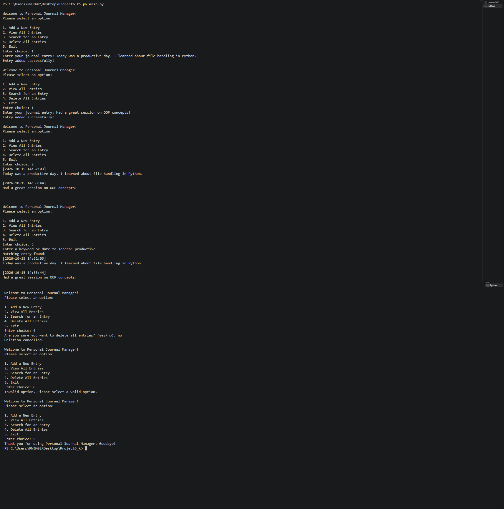

# 📓 Personal Journal Manager

### A menu-driven Python application for managing your daily journal entries


---

## 📖 Project Description

**Personal Journal Manager** is a command-line application built in Python that lets users record and manage their daily thoughts in a simple text file. It demonstrates core programming concepts such as **file handling**, **exception handling**, and **object-oriented programming (OOP)** through a `JournalManager` class.

Every entry is automatically saved with a date and time stamp in `journal.txt`, so users can easily look back at what they wrote and when.

---

## ✨ Features

- ➕ **Add a New Entry** – Write a journal entry that is saved with an automatic timestamp.
- 📂 **View All Entries** – Display every saved entry in the order it was written.
- 🔍 **Search for an Entry** – Find entries by keyword or date (case-insensitive).
- 🗑️ **Delete All Entries** – Remove the journal file, with a confirmation prompt to prevent accidental loss.
- 🛡️ **Error Handling** – Gracefully handles missing files and invalid menu choices.
- 🔁 **Interactive Menu** – Runs in a loop until the user chooses to exit.

---

## 🛠️ Technologies Used

| Technology | Purpose |
|------------|---------|
| 🐍 **Python 3** | Core programming language |
| 💻 **VS Code** | Code editor used for development |
| 🐙 **Git and GitHub** | Version control and project hosting |
| 📦 **`datetime` module** | Generating entry timestamps |
| 📁 **`os` module** | Checking and deleting the journal file |

---

## 🚀 How to Run

### Prerequisites
- Python 3.x installed on your system ([Download here](https://www.python.org/downloads/))

### Steps

1. **Clone the repository**
   ```bash
   git clone https://github.com/<your-username>/<your-repository-name>.git
   ```

2. **Navigate to the project folder**
   ```bash
   cd <your-repository-name>
   ```

3. **Run the program**
   ```bash
   python main.py
   ```
   > 💡 On Windows you can also use: `py main.py`

4. **Use the menu** – Enter a number from `1` to `5` to choose an option.

---

## 📁 Project Structure

```
├── 📄 main.py        # JournalManager class and main menu logic
├── 📝 journal.txt    # Auto-generated file that stores journal entries
├── 🖼️ output.png     # Screenshot of the program output
└── 📘 README.md      # Project documentation
```

---

## 🖥️ Output



## 👩‍💻 Author

**Kajal**

---

